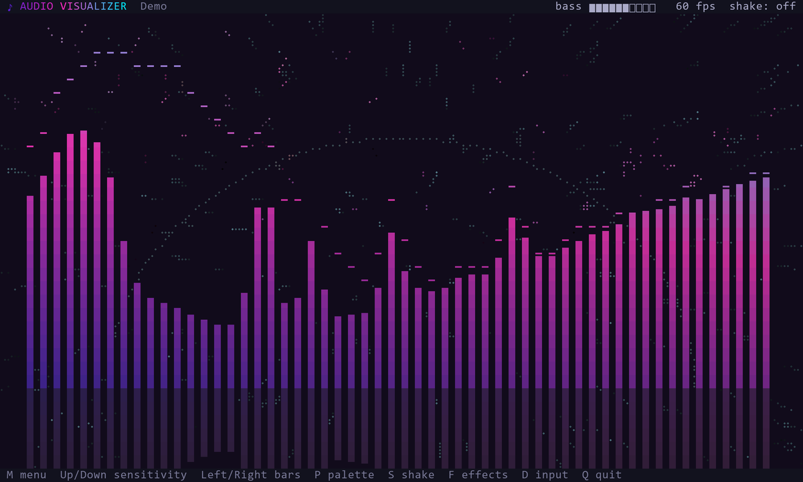

# Audio Visualizer

Terminal audio visualizer. The bars have a color fade and, when a strong bass hits, the terminal window shakes.



## Usage

```bash
# Windows
pip install -r requirements.txt
python visualizer.py

# Linux (PulseAudio or PipeWire)
sudo apt install python3-numpy pulseaudio-utils
python3 visualizer.py

python visualizer.py --demo   # no need to play anything
```

Keys: `M` menu, `P` palette, `S` shake, `F` effects, `Q` quit.

Too sensitive? Press `Down` (or open the menu with `M`). Sensitivity goes down to x0.02.

On Linux the window only shakes on X11/XWayland; on pure Wayland only the content shakes.
